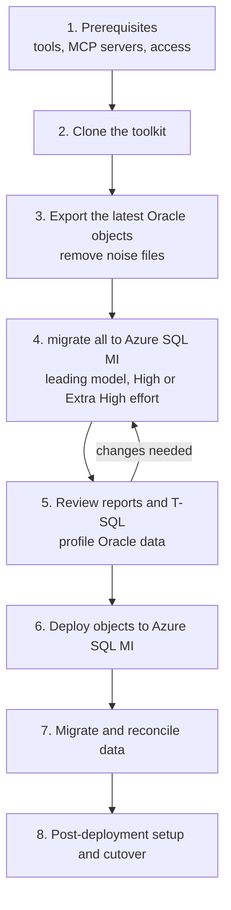
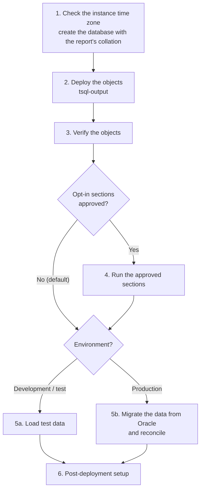

# Oracle to Azure SQL Managed Instance – Migration Runbook (generic)

Step-by-step guide to converting **any Oracle schema** to T-SQL with this toolkit's AI agents, reviewing the result and deploying it to **Azure SQL Managed Instance**. Every step gives the commands for:

- **Windows**: PowerShell 5.1 or PowerShell 7. Don't use the Command Prompt (`cmd.exe`).
- **macOS**: Terminal with zsh (the default shell) or bash. Linux uses the macOS commands.

Values that depend on your package (counts, collation, run order, opt-in sections) come from the migration report the agents write. This runbook tells you where to find them.

## Placeholders

Replace these values throughout, and keep a note of them; every step reuses them.

| Placeholder | Meaning | Example |
|-------------|---------|---------|
| `<SCHEMA>` | Oracle schema (owner) to migrate, in upper case | `HR` |
| `<target-schema>` | SQL Server schema for the converted objects. You set it in the prompt ([5.2](#52-option-a-copilot-cli-recommended)); usually the Oracle schema name | `HR` |
| `<database-name>` | New database on the managed instance | `HR` |
| `<file>` | Converted file, relative to `tsql-output/`. It has the same relative path as the input file in `oracle-sql/` | `hr_schema.sql` |
| `<collation>` | Database collation chosen in the report ([6.1](#61-read-the-report)) | `Latin1_General_100_BIN2` |
| `<time-zone-id>` | Windows time zone ID of the business time zone ([7.3.1](#731-time-zone)) | `AUS Eastern Standard Time`, `GMT Standard Time`, `Eastern Standard Time` |
| `<mi-name>.<dns-zone>` | Host name of the managed instance | |

The commands use the project folder `~/work/oracle-migration` (macOS) or `C:\work\oracle-migration` (Windows). Use one folder per migration project; rename it if you like, for example `hr-migration`.

**Several schemas.** Export each schema into its own subfolder of `oracle-sql/`, list every schema and its target schema in the prompt, and run the schema-specific queries and checks once per schema.

**Testing.** The commands were tested on macOS with zsh and PowerShell 7.5, the Go-based `sqlcmd` 1.11.0, and SQL Server 2022 in a Linux container. They haven't yet been run on Windows, with the ODBC-based `sqlcmd`, or against a managed instance. The Oracle queries couldn't be run, because no Oracle database was available.

## Contents

1. [Overview](#1-overview)
2. [Prerequisites](#2-prerequisites)
3. [Get the toolkit](#3-get-the-toolkit)
4. [Export the latest Oracle objects](#4-export-the-latest-oracle-objects)
5. [Run the migration](#5-run-the-migration)
6. [Review the output](#6-review-the-output)
7. [Deploy to Azure SQL Managed Instance](#7-deploy-to-azure-sql-managed-instance)
8. [Migration record](#8-migration-record)

---

## 1. Overview



| Role | Steps |
|------|-------|
| Migration engineer | Prerequisites, clone, run the agents, review the output ([2](#2-prerequisites)–[6](#6-review-the-output)) |
| Oracle DBA | Export the objects, run the source-fact and profiling queries, provide a consistent data snapshot ([4](#4-export-the-latest-oracle-objects), [6.2](#62-run-the-oracle-profiling-queries), [7.6](#76-production-data-migration-from-oracle)) |
| Azure / SQL Server DBA | Instance time zone, database, deployment, data load ([7](#7-deploy-to-azure-sql-managed-instance)) |
| Security | Grants, users and roles ([7.4.5](#745-optional-opt-in-sections), [7.7](#77-post-deployment-setup)) |
| Application team | Behaviour changes, acceptance testing, cutover |

---

## 2. Prerequisites

### 2.1 Access

| # | Item | Notes |
|---|------|-------|
| 1 | **GitHub Copilot** subscription with Copilot CLI enabled | Your organisation's policy must allow the models in [5.1](#51-choose-the-model-and-effort) and MCP servers. |
| 2 | Access to `https://github.com/szenatti/oracle-to-tsql` | To clone the toolkit. |
| 3 | **Oracle** read access to the source schema | To export DDL and run catalog and profiling queries. Export as the schema owner, or as a user with `SELECT_CATALOG_ROLE`, so the tools can generate complete DDL ([4.2](#42-option-a-oracle-sql-developer)). |
| 4 | **Azure SQL Managed Instance** created with the **business time zone** | The time zone can only be set when the instance is created; the default is UTC. See [7.3.1](#731-time-zone). |
| 5 | Permissions on the managed instance | Permission to create a database (or a DBA who creates it), and `db_owner` on it. For Microsoft Entra sign-in, an Entra admin must be set on the instance. |
| 6 | Network path to the managed instance | Private endpoint on port **1433** (VNet, peered network, VPN or ExpressRoute), or the public endpoint on port **3342** if it's enabled and the network security group allows it. |
| 7 | A **Windows** machine for SSMA (data migration only) | SSMA for Oracle runs on Windows 11 or Windows Server 2022 and later. Mac users need a Windows VM or jump box, or use another loader ([7.6](#76-production-data-migration-from-oracle)). |

### 2.2 Workstation tools

| Tool | Used for | Windows (PowerShell) | macOS (Terminal) |
|------|----------|----------------------|------------------|
| Git | Clone the toolkit | `winget install --id Git.Git -e` | `xcode-select --install` or `brew install git` |
| **GitHub Copilot CLI** (recommended) | Run the agents, process files in parallel | `winget install GitHub.Copilot` | `brew install --cask copilot-cli` |
| *or* VS Code with GitHub Copilot Chat | Run the agents, one file at a time | `winget install -e --id Microsoft.VisualStudioCode` | `brew install --cask visual-studio-code` |
| Python 3.13 and uv | Oracle documentation MCP server | `winget install -e --id Python.Python.3.13` and `winget install -e --id astral-sh.uv` | `brew install python@3.13 uv` |
| `sqlcmd` (Go-based) | Deploy and verify | `winget install sqlcmd` | `brew install sqlcmd` |
| Oracle SQL Developer *or* TOAD for Oracle | Export the DDL | Either | SQL Developer (TOAD for Oracle is Windows-only) |
| Docker Desktop (recommended) | Lets the agents compile the output in a disposable SQL Server 2022 container during the migration. Start it before [5](#5-run-the-migration). On Apple silicon, turn on *Use Rosetta for x86_64/amd64 emulation* in Docker Desktop settings | [Docker Desktop for Windows](https://docs.docker.com/desktop/setup/install/windows-install/) | [Docker Desktop for Mac](https://docs.docker.com/desktop/setup/install/mac-install/) |
| SQL Server Management Studio (optional) | Deploy from a GUI ([7.8](#78-ssms-alternative-windows)) | [Download SSMS](https://learn.microsoft.com/sql/ssms/install/install) | Not available |
| SSMA for Oracle | Data migration ([7.6](#76-production-data-migration-from-oracle)) | [Install SSMA for Oracle](https://learn.microsoft.com/sql/ssma/oracle/installing-ssma-for-oracle-client-oracletosql) | Windows VM |
| Azure CLI (optional) | Managed instance checks | `winget install -e --id Microsoft.AzureCLI` | `brew install azure-cli` |

Other ways to install Copilot CLI: `npm install -g @github/copilot` (Node.js 22 or later, any OS), or `curl -fsSL https://gh.io/copilot-install | bash` (macOS and Linux).

Open a **new** terminal after installing, so that the `PATH` changes apply, then check:

```
git --version
copilot --version
sqlcmd --version
uv --version
```

`sqlcmd --version` prints a version number for the Go-based `sqlcmd`. The older ODBC-based `sqlcmd` prints `Unknown Option`; see [7.3.3](#733-client-machine).

### 2.3 Documentation MCP servers

The agents check behaviour they aren't sure about against official documentation through two MCP servers. Without them the migration still runs, but every point the agents couldn't check is marked `-- MIGRATION WARNING: unverified`, which means more manual review.

| Server | Covers | Setup |
|--------|--------|-------|
| Microsoft Learn MCP (`https://learn.microsoft.com/api/mcp`) | SQL Server, Azure SQL, T-SQL | Hosted; nothing to install |
| Oracle Database Documentation MCP (`oracle-db-doc`) | Oracle SQL and PL/SQL | Local Python server, plus a documentation index you build once (takes several minutes) |

1. Install the Oracle server and build its index for the Oracle version you're migrating from: [README → Install the Oracle server](README.md#install-the-oracle-server). The README has the commands for both macOS and Windows.
2. Register both servers in your user configuration: `~/.copilot/mcp-config.json` on macOS, `%USERPROFILE%\.copilot\mcp-config.json` on Windows. See [README → Register both servers](README.md#register-both-servers). VS Code and Copilot CLI share this file.
3. Check that both are available:
   - In a terminal: `copilot mcp list`.
   - In a Copilot CLI session: `/mcp`. Both `microsoft-learn` and `oracle-db-doc` must be listed.
   - In VS Code: Command Palette → **MCP: List Servers**.
4. Optional smoke test. In a Copilot session, ask: *Search the Oracle documentation for DECODE and Microsoft Learn for SET XACT_ABORT, and tell me which tools you used.*

---

## 3. Get the toolkit

Use a **fresh clone for each migration project**.

**macOS**

```bash
mkdir -p ~/work && cd ~/work
git clone https://github.com/szenatti/oracle-to-tsql.git oracle-migration
cd oracle-migration
```

**Windows (PowerShell)**

```powershell
New-Item -ItemType Directory -Force C:\work | Out-Null
Set-Location C:\work
git clone https://github.com/szenatti/oracle-to-tsql.git oracle-migration
Set-Location oracle-migration
```

| Path | Contents |
|------|----------|
| `oracle-sql/` | **Input.** Oracle files to migrate (empty after cloning) |
| `tsql-output/` | Output. Converted T-SQL, same relative paths as the input |
| `migration-reports/` | Output. One consolidated report per input file |
| `migration-exclusions.json` | Your decisions on backup, dated and leftover tables |
| `.github/` | Agents, conversion rules (skills) and the Copilot CLI extension |
| `samples/` | Sample Oracle files for trying out the pipeline |

> `oracle-sql/`, `tsql-output/` and `migration-reports/` are listed in `.gitignore`. That keeps your schema and results from being committed to the toolkit repository by accident. Keep the reviewed results in your own controlled repository; see [6.4](#64-keep-the-reviewed-package).

---

## 4. Export the latest Oracle objects

**Goal:** `oracle-sql/` contains **one current definition of every object you want to migrate, and nothing else.**

The agents read every file in the folder. Old versions, one-off scripts and unrelated files consume AI credits, slow the run and can produce wrong conversions, for example from an obsolete column definition.

### 4.1 Record the source facts

Run these queries in SQL Developer, TOAD or SQL*Plus as a user who can read the catalog. Replace `<SCHEMA>` with your schema name in upper case; for several schemas, use `owner IN ('<SCHEMA1>', '<SCHEMA2>')`. Keep the results: you'll put them in the migration prompt ([5.2](#52-option-a-copilot-cli-recommended)) and compare them with the export ([4.5](#45-check-the-input-folder)).

```sql
-- 1. Oracle version (if v$version isn't accessible: SELECT * FROM product_component_version;)
SELECT * FROM v$version;

-- 2. Character sets and comparison settings
SELECT parameter, value
FROM   nls_database_parameters
WHERE  parameter IN ('NLS_CHARACTERSET', 'NLS_NCHAR_CHARACTERSET', 'NLS_LENGTH_SEMANTICS',
                     'NLS_COMP', 'NLS_SORT', 'NLS_TERRITORY');

-- 3. Clock. SYSDATE follows the operating-system clock of the database server.
SELECT DBTIMEZONE, SESSIONTIMEZONE, SYSTIMESTAMP, SYSDATE FROM dual;

-- 4. Object inventory, excluding recycle-bin objects
SELECT object_type, status, COUNT(*) AS objects
FROM   all_objects
WHERE  owner = '<SCHEMA>' AND object_name NOT LIKE 'BIN$%'
GROUP  BY object_type, status
ORDER  BY object_type, status;

-- 5. Dependencies on other schemas and database links
SELECT DISTINCT referenced_owner, referenced_name, referenced_type, referenced_link_name
FROM   all_dependencies
WHERE  owner = '<SCHEMA>'
AND    (referenced_owner NOT IN ('<SCHEMA>', 'SYS', 'PUBLIC') OR referenced_link_name IS NOT NULL);
```

- The offset in `SYSTIMESTAMP` is the database server's clock. That's the time zone the existing `SYSDATE` values are in, and the time zone the managed instance must use ([7.3.1](#731-time-zone)). `DBTIMEZONE` alone doesn't tell you this.
- For `INVALID` objects, decide with the application owner whether to migrate them.
- Query 5 shows what the schema needs from outside the export: other schemas, public synonyms and database links. Plan for each one ([7.7](#77-post-deployment-setup)).
- If you don't record these facts, the agents have to infer them, and the report lists them as open checks.

### 4.2 Option A: Oracle SQL Developer

Available on Windows and macOS.

1. Connect as the **schema owner**, or as a user with `SELECT_CATALOG_ROLE`. With fewer privileges, SQL Developer can't generate all DDL through `DBMS_METADATA`. It then writes `Unable to render TABLE DDL … attempting internal generator` and falls back to a generator that can omit details. [4.5](#45-check-the-input-folder) checks the export for this message.
2. Select **Tools → Database Export**.
3. **Source/Destination**:
   - **Connection**: the source database.
   - **Export DDL**: selected. Choose the DDL options, for example:
     - **Show Schema** on, for schema-qualified names.
     - **Terminator** on.
     - **Pretty Print** on.
     - **Storage** off. Tablespace and storage clauses are dropped in the conversion anyway.
     - **Grants** on, only if you want privileges mapped.
   - **Export Data**: **clear it.** Data is migrated separately ([7.6](#76-production-data-migration-from-oracle)).
   - **Save As**: a single file, or one of the per-object or per-type options (easier to review and to rerun one file). The file names must end in `.sql`. Save outside the repository first, for example to `~/exports/hr/` or `C:\exports\hr\`.
4. **Types to Export**: select the object types you migrate (tables, indexes, constraints, sequences, views, triggers, functions, procedures, packages, types). Clear the rest.
5. **Specify Objects**: select the schema and objects. Leave out recycle-bin objects (`BIN$…`).
6. Select **Finish**, then copy the files into `oracle-sql/`.

Oracle reference: [Creating an installation script with the Database Export wizard](https://docs.oracle.com/en/database/oracle/oracle-database/19/tdddg/creating-installation-script-database-export-wizard.html).

### 4.3 Option B: TOAD for Oracle

Windows only.

1. Connect as the schema owner.
2. Select **Database → Export → Generate Schema Script**.
3. Select the schema and the object types. Leave out data and storage clauses (option names vary between TOAD versions).
4. Write the script to one or more `.sql` files, then copy them into `oracle-sql/`.

### 4.4 Option C: Source control

Use this option if the DDL is maintained in Git, Azure DevOps or SVN. Repositories usually hold far more than the current state, so **copy only the latest database artifacts**.

1. Check out the branch or tag that matches **what's deployed in production**, for example `git checkout <release-tag>`.
2. Copy the latest object definitions to `oracle-sql/`, leaving the noise behind:

| Leave out | Why |
|-----------|-----|
| Folders for earlier Oracle or application versions (`archive/`, `old/`, `v1/`, `11g/`, …) | The agents would convert obsolete definitions, and you'd pay for it |
| One-off release, patch, data-fix and rollback scripts | Their effects are already in the Oracle data. Running them again on migrated data would apply the changes twice |
| Test-data and seed scripts | Unless you want them converted for development and test ([7.5](#75-development-and-test-data)) |
| Several copies of the same object | Duplicates cost credits and can conflict |
| Install wrappers that only call other files (`@@file.sql`) | Copy the files they call instead |
| Non-database files (Java, XML, documentation, build files) | Not migrated |

**macOS**

```bash
SRC="$HOME/src/<database-repository>"            # source-control working copy, at the production release
DEST="$HOME/work/oracle-migration/oracle-sql"

rsync -av --prune-empty-dirs \
  --exclude '.git/' --exclude 'archive/' --exclude 'old/' --exclude 'releases/' --exclude 'rollback/' \
  --include '*/' \
  --include '*.sql' --include '*.pls' --include '*.pks' --include '*.pkb' --include '*.trg' \
  --include '*.vw' --include '*.fnc' --include '*.prc' --include '*.typ' \
  --exclude '*' \
  "$SRC/" "$DEST/"
```

**Windows (PowerShell)**

```powershell
$Src  = 'C:\src\<database-repository>'           # source-control working copy, at the production release
$Dest = 'C:\work\oracle-migration\oracle-sql'

robocopy $Src $Dest *.sql *.pls *.pks *.pkb *.trg *.vw *.fnc *.prc *.typ /S /XD .git archive old releases rollback /NP
if ($LASTEXITCODE -ge 8) { throw "robocopy failed with exit code $LASTEXITCODE" }
```

Replace the excluded folder names with the ones your repository uses. The extensions are the ones the toolkit supports. `robocopy` exit codes below 8 mean success.

### 4.5 Check the input folder

**macOS**

```bash
cd ~/work/oracle-migration
find oracle-sql -type f ! -name .gitkeep | sort                          # files to migrate
find oracle-sql -type f ! -name .gitkeep -exec cat {} + | wc -l          # total lines
grep -rliE "identified by|password" oracle-sql                           # must return nothing
grep -rc "Unable to render" oracle-sql | grep -v ':0$'                   # must return nothing
```

**Windows (PowerShell)**

```powershell
Set-Location C:\work\oracle-migration
Get-ChildItem oracle-sql -Recurse -File -Exclude .gitkeep | Select-Object -ExpandProperty FullName
(Get-ChildItem oracle-sql -Recurse -File -Exclude .gitkeep | Get-Content | Measure-Object -Line).Lines
Get-ChildItem oracle-sql -Recurse -File | Select-String -Pattern 'identified by|password' -List | Select-Object -ExpandProperty Path
Get-ChildItem oracle-sql -Recurse -File | Select-String -Pattern 'Unable to render' | Group-Object Path | ForEach-Object { '{0}  {1}' -f $_.Count, $_.Name }
```

- **Remove credentials** before running the agents, for example the password in `CREATE DATABASE LINK … IDENTIFIED BY`. Don't send secrets to an AI service.
- **`Unable to render` messages** mean the export fell back to SQL Developer's internal generator ([4.2](#42-option-a-oracle-sql-developer)). Export again as the schema owner.
- Compare the files with the inventory from [4.1](#41-record-the-source-facts). Every object type and object you want to migrate should be present.
- **Backup, dated and leftover tables.** The agents comment out tables such as `ORDERS_BAK`, `ORDERS_20211014` and `TMP_ORDERS`, and they flag ambiguous names (`_OLD`, `_NEW`, `_ARCHIVE`) for a decision. If you already know the answer, record it in `migration-exclusions.json` before you start. Format: [object-exclusions.md](.github/skills/oracle-tsql-reference/references/object-exclusions.md#project-overrides).
- Optional, Copilot CLI only: ask *Scan all Oracle SQL files in the project*. The `scan_oracle_files` tool lists the files, and the excluded and flagged tables, before any conversion credits are spent.

---

## 5. Run the migration

### 5.1 Choose the model and effort

Use a **leading model** with **High** or **Extra High** reasoning effort. Conversion and validation need long, rule-heavy reasoning, and smaller models miss silent behaviour differences.

| Model | Copilot CLI model ID | Effort |
|-------|----------------------|--------|
| GPT-Sol 6.2 | `gpt-6.2-sol` | `high`, or `xhigh` (Extra High) |
| Claude Opus 5.5 | `claude-opus-5.5` | `high`, or `xhigh` (Extra High) |

- Which models you can use depends on your Copilot plan and organisation policy. `/model` lists them.
- Higher effort uses more AI credits and takes longer. That's why the clean-up in section 4 matters.
- Use the same model for all phases of a file.

### 5.2 Option A: Copilot CLI (recommended)

The commands are the same on Windows (PowerShell) and macOS.

1. Open a terminal in the repository root: `cd ~/work/oracle-migration` (macOS) or `Set-Location C:\work\oracle-migration` (Windows).
2. Start Copilot with the model and effort:
   ```
   copilot --model claude-opus-5.5 --reasoning-effort xhigh
   ```
   or `copilot --model gpt-6.2-sol --reasoning-effort high`. You can also start `copilot`, type `/model`, select the model, and use **←/→** to set the effort.
3. On the first start:
   - Sign in with `/login` if asked.
   - Answer the folder-trust question with **Yes** or **Yes, and remember this folder**. **No** exits.
4. Type `/mcp` and check that `microsoft-learn` and `oracle-db-doc` are listed ([2.3](#23-documentation-mcp-servers)).
5. Optional: type `/subagents` and set the phase agents to the same model and effort. The orchestrator runs every phase as a sub-agent.
6. Select the orchestrator with `/agent migration-orchestrator`, or start Copilot with `--agent migration-orchestrator`.
7. Send the prompt. Fill in the template with your facts from [4.1](#41-record-the-source-facts) and the placeholders:

   ```text
   migrate all to Azure SQL Managed Instance

   Source facts:
   - Oracle <version>, schema <SCHEMA>
   - NLS_CHARACTERSET <value>, NLS_LENGTH_SEMANTICS <value>, NLS_COMP <value>
   - Database server clock: <SYSTIMESTAMP offset and location>
   - <other facts from 4.1, for example invalid objects to skip, other schemas or database links used>

   Target:
   - Azure SQL Managed Instance, new dedicated database
   - Instance time zone: <time-zone-id>
   - SQL Server schema: <target-schema>
   - Collation: recommend one that keeps Oracle's case-sensitive comparisons, and record it in the report
   - One deployable script per source file in tsql-output/, one consolidated report per file in migration-reports/
   - If there are several output files, also write tsql-output/deploy_all.sql, which runs them in dependency order with :r $(OutDir)/<file>
   - Add a Deployment section at the end of each report: run order, required collation, whether the script is all-or-nothing or can be rerun, safety checks and their error numbers, opt-in sections, objects not created, and the expected object counts
   - Compile the output in a disposable SQL Server 2022 container, record the result and object counts in the report's validation section, and remove the container afterwards. If Docker isn't available, say so in the report
   ```

   For example: `Oracle 19c, schema HR`, `Database server clock: UTC+10:00 (Sydney)`, `Instance time zone: AUS Eastern Standard Time`, `SQL Server schema: HR`.

   **Many files:** send the prompt as `/fleet <prompt>` (or start with `copilot --fleet`). Copilot then runs sub-agents in parallel.
8. **Approve tool requests with care.** The agents write to `tsql-output/` and `migration-reports/` and run read-only commands. They never need Oracle or Azure credentials. Don't use `--allow-all` on a machine that can reach production databases.
9. Follow the progress:

   | Command | Shows |
   |---------|-------|
   | `/tasks` | Running sub-agents |
   | `status` (orchestrator selected) or `@migration-orchestrator status` | Which phases each file has completed |
   | `retry failed` | Reruns the files that failed |

The orchestrator runs **evaluate → convert → validate → analyze** for each file, then writes a consolidated list of action items. Results:

- `tsql-output/<same relative path as the input>`: converted T-SQL.
- `migration-reports/migration-<file>.md`: one report per file.
- `migration-reports/.migration-state.json`: Copilot CLI progress state.

### 5.3 Option B: VS Code with GitHub Copilot Chat

1. Open the repository folder in VS Code (on macOS, `code .` works only after **Shell Command: Install 'code' command in PATH**).
2. Open the Chat view (`Ctrl+Shift+I` on Windows, `Cmd+Shift+I` on macOS).
3. Select the **migration-orchestrator** agent (or type `@migration-orchestrator`), choose the model in the model picker, and pick the higher reasoning level if your VS Code offers one.
4. Send the same prompt as in [5.2](#52-option-a-copilot-cli-recommended).

VS Code processes files one at a time, because the extension tools and parallel sub-agents are Copilot CLI only. Details: [GUIDE.md](GUIDE.md#using-with-vs-code--github-copilot-chat).

### 5.4 Rerun one phase

Use the individual agents to rework a single file after review:

```
@oracle-evaluator evaluate oracle-sql/<file>
@oracle-to-tsql convert oracle-sql/<file>
@tsql-validator validate tsql-output/<file>
@performance-analyzer analyze tsql-output/<file>
```

---

## 6. Review the output

The agents' output is a **draft for expert review**. Don't deploy it until the checklist in [6.3](#63-sign-off-checklist) is complete.

### 6.1 Read the report

Open `migration-reports/migration-<file>.md`. The sections below follow the toolkit's report template; the agents sometimes adjust headings or numbering, so look for the same content.

| Section | What to check |
|---------|---------------|
| Evaluation summary | Complexity, Oracle version, **target collation**, counts, recommendation |
| 1.1 Object Inventory | Every source object is accounted for; compare with the inventory from [4.1](#41-record-the-source-facts) |
| 1.2 Oracle-Specific Features | Data type, function, PL/SQL and syntax mappings. Look for clock functions (`SYSDATE`), sequences and `USER` |
| 1.3 Semantic Differences | Findings (`F-nnn`) on behaviour that changes; 🔴 findings must be resolved or accepted by an owner |
| 1.4 Dependencies | Other schemas, database links and objects outside the export |
| 1.5 Risk Assessment, 1.6 Migration Recommendations | Priorities |
| 1.7 Data Profiling | Queries for the Oracle DBA ([6.2](#62-run-the-oracle-profiling-queries)) |
| 1.8 Excluded and Commented-Out Code | Approve every `EX-` (commented out) and `FL-` (flagged) row |
| Part 2: Validation | Compile result in the container, what was tested, and **what wasn't** |
| Part 3: Performance Analysis | Index and load recommendations |
| Consolidated Action Items | Give every item an owner |
| Deployment (requested in [5.2](#52-option-a-copilot-cli-recommended)) | Run order, collation, all-or-nothing or rerunnable, opt-in sections, expected counts. [7](#7-deploy-to-azure-sql-managed-instance) uses it |

If the Deployment section is missing, ask: `@migration-orchestrator add the Deployment section to migration-reports/migration-<file>.md`.

### 6.2 Run the Oracle profiling queries

Some mapping decisions depend on the data, for example whether a bare `NUMBER` holds fractions, or whether keys differ only by case or by trailing spaces.

1. Give the queries in report section 1.7 to the Oracle DBA. Run them on a copy of production, or off-peak.
2. Record the results in the report.
3. If a result changes a mapping, ask the agent to update the script and the report, then validate again:
   ```
   @oracle-to-tsql update tsql-output/<file>: <decision and the profiling result>; update the report
   @tsql-validator validate tsql-output/<file> and compile it again in a disposable SQL Server 2022 container
   ```

`-- MIGRATION TODO:` comments that name a profiling check (for example `P7 pending`) are closed by the profiling results, not by editing code.

Query catalog: [oracle-profiling-queries.md](.github/skills/oracle-data-profiling/references/oracle-profiling-queries.md).

### 6.3 Sign-off checklist

- [ ] Every source object is accounted for (report 1.1 compared with the inventory from 4.1).
- [ ] Every 🔴 finding is resolved, or accepted with a named owner.
- [ ] Every `EX-` and `FL-` row is approved, and the decisions are recorded in `migration-exclusions.json`.
- [ ] The profiling queries have run and the data-dependent mappings are final.
- [ ] Collation and time zone are decided and recorded.
- [ ] Part 2 (Validation) shows the script compiled in a disposable SQL Server 2022 container, and the Deployment section lists the expected object counts. If the script changed since, ask `@tsql-validator` to compile it again.
- [ ] Every dependency in 1.4 (other schemas, database links) has a plan.
- [ ] The application team has reviewed the behaviour changes in 1.3.
- [ ] The reviewed package is stored and versioned ([6.4](#64-keep-the-reviewed-package)).

### 6.4 Keep the reviewed package

Copy `tsql-output/` and `migration-reports/` into your deployment repository or artifact store, and tag the version you deploy. They're excluded from Git in the toolkit clone ([3](#3-get-the-toolkit)). To commit them to the clone anyway, use `git add -f tsql-output migration-reports`.

---

## 7. Deploy to Azure SQL Managed Instance

Read the report's **Deployment** section first ([6.1](#61-read-the-report)). It holds the values specific to your package; this section shows where each one is used.

### 7.1 Package contents

| Path | Contents | Deploy to |
|------|----------|-----------|
| `tsql-output/<file>` (one per input file) | Converted objects | Every environment |
| `tsql-output/deploy_all.sql` (several files only) | Runs the files in dependency order | Every environment |
| Converted seed or reference-data scripts (if any) | Test data | Development and test only ([7.5](#75-development-and-test-data)) |
| `migration-reports/migration-<file>.md` | Decisions, findings, exclusions, action items, deployment conditions | Not deployed; it's the review record |

> 🔴 **Check the instance time zone before deploying.** Azure SQL Managed Instance uses **UTC by default**, and you **can't change** the time zone after the instance is created. On a UTC instance, every date and time the database fills in automatically is saved in UTC instead of local business time. See [7.3.1](#731-time-zone).

### 7.2 Deployment sequence



| Step | Action | Section |
|------|--------|---------|
| 1 | Check the time zone, create the database, prepare the client machine | [7.3](#73-prerequisites), [7.4.1](#741-set-the-connection-details)–[7.4.2](#742-create-the-database-and-test-the-connection) |
| 2–3 | Deploy and verify the objects | [7.4.3](#743-run-the-deployment)–[7.4.4](#744-verify) |
| 4 | Optional: run the approved opt-in sections | [7.4.5](#745-optional-opt-in-sections) |
| 5a | Development/test: load test data | [7.5](#75-development-and-test-data) |
| 5b | Production: migrate and reconcile the Oracle data | [7.6](#76-production-data-migration-from-oracle) |
| 6 | Users, roles, read consistency, statistics, cutover | [7.7](#77-post-deployment-setup) |

**What to take from the report's Deployment section**

| Item | Used in |
|------|---------|
| Run order (one file, `deploy_all.sql`, or a list) | [7.4.3](#743-run-the-deployment) |
| Required collation | [7.3.2](#732-target-database), [7.4.2](#742-create-the-database-and-test-the-connection) |
| Script style: all-or-nothing or rerunnable (table below) | Recovering from a failed run ([7.4.3](#743-run-the-deployment)) |
| Safety checks and their error numbers, for example a check that stops the script in `master` | [7.9](#79-troubleshooting) |
| SQLCMD commands (`:ON ERROR EXIT`, `:r`, `$(var)`) | `sqlcmd` handles them; SSMS needs SQLCMD Mode ([7.8](#78-ssms-alternative-windows)) |
| Opt-in sections, for example grants that mean something different in SQL Server | [7.4.5](#745-optional-opt-in-sections) |
| Objects not created | [7.7](#77-post-deployment-setup) |
| Expected object counts | [7.4.4](#744-verify) |

**Script style.** This decides what happens when a run fails.

| Style | How to recognise it | After an error |
|-------|---------------------|----------------|
| **All-or-nothing** | `BEGIN TRANSACTION` … `COMMIT TRANSACTION` around the objects, with `SET XACT_ABORT ON` or `:ON ERROR EXIT` | Everything is rolled back. Fix the cause and run the same command again |
| **Rerunnable** | `IF NOT EXISTS` checks and `CREATE OR ALTER` around each object | Objects created before the error stay. Fix the cause and run the same command again |
| **Neither** | Plain `CREATE` statements | The database is partly deployed. Drop it, create it again ([7.4.2](#742-create-the-database-and-test-the-connection)), fix the cause and rerun |

**Usually not created by the scripts:**

- logins, database users and role memberships ([7.7](#77-post-deployment-setup));
- statements commented out in report section 1.8 (`EX-` rows);
- opt-in sections, until they're approved ([7.4.5](#745-optional-opt-in-sections));
- SQL Server Agent jobs for Oracle `DBMS_SCHEDULER` or `DBMS_JOB` jobs;
- replacements for database links and Oracle Text, unless the report says otherwise.

### 7.3 Prerequisites

#### 7.3.1 Time zone

**Why it matters.** Oracle fills dates from `SYSDATE` and `SYSTIMESTAMP`, which follow the database server's clock. The converted code uses `SYSDATETIME()` or `GETDATE()`, which return the time in the **managed instance's time zone**. That affects:

| Where | Example |
|-------|---------|
| Date-and-time defaults (Oracle `DEFAULT SYSDATE`) | Created-on and modified-on columns |
| Date-only defaults (Oracle `DEFAULT TRUNC(SYSDATE)`) | Document or effective dates |
| Converted procedures, functions, triggers and views that read the clock | "Today", age and expiry calculations |
| SQL Server Agent job schedules | Schedules run in the instance time zone |
| Application SQL that uses `GETDATE()` / `SYSDATETIME()` | "Today" calculations |

To see how much of your schema reads the clock, search the export:

**macOS**

```bash
cd ~/work/oracle-migration
grep -rhoiE "SYSDATE|SYSTIMESTAMP|CURRENT_DATE|CURRENT_TIMESTAMP|LOCALTIMESTAMP" oracle-sql | wc -l   # clock references
grep -rliE "SYSDATE|SYSTIMESTAMP|CURRENT_DATE|CURRENT_TIMESTAMP|LOCALTIMESTAMP" oracle-sql             # files that use them
```

**Windows (PowerShell)**

```powershell
Set-Location C:\work\oracle-migration
$Clock = 'SYSDATE|SYSTIMESTAMP|CURRENT_DATE|CURRENT_TIMESTAMP|LOCALTIMESTAMP'
(Get-ChildItem oracle-sql -Recurse -File | Select-String -Pattern $Clock -AllMatches | ForEach-Object { $_.Matches.Count } | Measure-Object -Sum).Sum
Get-ChildItem oracle-sql -Recurse -File | Select-String -Pattern $Clock -List | Select-Object -ExpandProperty Path
```

**What goes wrong on a UTC instance.** If business time is UTC+10, for example:

- every timestamp the database fills in is **10 hours behind** local time;
- "today" is still **yesterday** until 10:00 local time, so date-only defaults are a day early;
- migrated Oracle rows (local time) and new rows (UTC) are **mixed in the same columns**, and nothing shows which is which;
- scheduled jobs run at the wrong local time.

No error is raised; the data is silently wrong. West of UTC the effect is reversed: dates run ahead.

**Check it** on the target instance before [7.4.3](#743-run-the-deployment). Any login can run this:

```sql
SELECT CURRENT_TIMEZONE_ID() AS time_zone_id,     -- expect <time-zone-id>
       CURRENT_TIMEZONE()    AS time_zone_name,   -- for example (UTC+10:00) Canberra, Melbourne, Sydney
       SYSDATETIMEOFFSET()   AS server_time;      -- the offset must match local time
```

The connection test in [7.4.2](#742-create-the-database-and-test-the-connection) runs the same check through `sqlcmd`.

**If the result is `UTC` or another wrong time zone:**

- ⛔ **Don't deploy or load data.** You can't change the time zone of an existing managed instance. Azure SQL Managed Instance also doesn't support the database-level and session-level settings (`ALTER DATABASE SCOPED CONFIGURATION SET TIME_ZONE`, `SET TIME ZONE`); they apply only to Azure SQL Database. See [SET TIME ZONE](https://learn.microsoft.com/sql/t-sql/statements/set-time-zone-transact-sql).
- Create a **new** managed instance with the correct time zone:
  - Azure portal: **Additional settings → Time zone**.
  - ARM or Bicep: the `timezoneId` property, for example `"timezoneId": "<time-zone-id>"`.
  - Azure CLI: `az sql mi create … --timezone-id "<time-zone-id>"`.
- If databases already exist on the wrong instance, move them with a cross-instance point-in-time restore, or backup and restore. Saved values are **not** converted; review rows created while the instance was on the wrong time zone.
- Use the **same time zone** in every environment (development, test, production) and on both instances of a failover group.

Reference, including the list of supported time zone IDs: [Time zones in Azure SQL Managed Instance](https://learn.microsoft.com/azure/azure-sql/managed-instance/timezones-overview).

> If the Oracle server clock was UTC, a UTC instance is correct. Otherwise, keep UTC only as a deliberate design decision, and only with code changes:
>
> - every clock default and every `GETDATE()` / `SYSDATETIME()` in converted and application SQL would convert to local time, for example `CONVERT(DATETIME2(0), SYSDATETIMEOFFSET() AT TIME ZONE '<time-zone-id>')`;
> - the migrated Oracle data would be converted to UTC;
> - the application would handle the change.
>
> The agents don't do this unless you ask for it in the prompt.

#### 7.3.2 Target database

| # | Item | Notes |
|---|------|-------|
| 1 | **Time zone** = business time zone | [7.3.1](#731-time-zone) |
| 2 | **Collation** = `<collation>` from the report | Oracle compares strings case-sensitively by default (`NLS_COMP = BINARY`); SQL Server's default collation doesn't. A binary (`_BIN2`) or case-sensitive (`_CS_`) collation keeps Oracle's behaviour. The instance (server) collation can stay at its default; the database collation is what matters. `#temp` tables use the `tempdb` collation, so converted code that creates them should set `COLLATE` explicitly or use `COLLATE DATABASE_DEFAULT`. |
| 3 | **New, empty database** | `CREATE DATABASE [<database-name>] COLLATE <collation>;` ([7.4.2](#742-create-the-database-and-test-the-connection)) |
| 4 | **Compatibility level** 150 or higher | The toolkit targets SQL Server 2019 and later. The connection test shows the level. |
| 5 | **Deployment account** | `db_owner` on the target database. To create the database you also need `CREATE ANY DATABASE` (or ask a DBA). |
| 6 | **Network access** | Private endpoint on port **1433**, or public endpoint `<mi-name>.public.<dns-zone>.database.windows.net` on port **3342** |
| 7 | Full-Text Search, SQL Server Agent | Needed only if the report says so, for example to replace Oracle Text indexes or `DBMS_SCHEDULER` jobs. Both are available on the managed instance. |

#### 7.3.3 Client machine

Deploy from **macOS, Linux or Windows** with `sqlcmd`, or from Windows with SSMS ([7.8](#78-ssms-alternative-windows)).

`sqlcmd` comes in two variants. Either works; the commands below show where they differ.

| | Go-based `sqlcmd` (recommended) | ODBC-based `sqlcmd` |
|---|---|---|
| Install on **Windows** | `winget install sqlcmd`, then open a new terminal | *Microsoft Command Line Utilities for SQL Server* plus *Microsoft ODBC Driver 18 for SQL Server*. Also installed with SQL Server. |
| Install on **macOS** | `brew install sqlcmd` | `mssql-tools18` (Homebrew tap `microsoft/mssql-release`) |
| Microsoft Entra sign-in with MFA | `--authentication-method ActiveDirectoryInteractive -U <user>` (all platforms) | `-G -U <user>` (**Windows only**; `-G` must come before `-U`) |
| `-I` (`QUOTED_IDENTIFIER ON`) | Accepted; it's always on | Required |
| Script encoding (UTF-8 without BOM) | Read as UTF-8 automatically. **Don't add `-f`** | **Windows: add `-f 65001`** |
| Server certificate | Fine for the managed instance | Encrypts and validates by default |

With the ODBC variant on Windows, always add `-f 65001`. Without it, non-ASCII characters in object names, defaults, check constraints or descriptions can be changed without any error.

**Check which variant runs.** On Windows, an older ODBC-based `sqlcmd` from SQL Server or SSMS is often first on the `PATH`.

```bash
# macOS / Linux
which -a sqlcmd        # every sqlcmd on the PATH; the first one is used
sqlcmd --version       # Go-based: prints a version number; ODBC-based: "Unknown Option"
```

```powershell
# Windows (PowerShell)
Get-Command sqlcmd -All | Select-Object -ExpandProperty Source   # every sqlcmd on the PATH; the first one is used
sqlcmd --version                                  # Go-based: prints a version number; ODBC-based: "Unknown Option"
```

**File names.** Converted file names can contain spaces, so always quote paths, as the commands below do.

### 7.4 Deploy the database objects

Each step shows two versions:

- **macOS / Linux**: zsh or bash.
- **Windows (PowerShell)**: Windows PowerShell 5.1 or PowerShell 7.

Keep the same terminal open for all the steps, because the settings last only for that session.

#### 7.4.1 Set the connection details

Replace the `<…>` placeholders.

**macOS / Linux**

```bash
cd ~/work/oracle-migration                       # folder that contains tsql-output/

export SERVER="<mi-name>.<dns-zone>.database.windows.net,1433"            # private endpoint
# export SERVER="<mi-name>.public.<dns-zone>.database.windows.net,3342"   # public endpoint
export DATABASE="<database-name>"
export TARGET_SCHEMA="<target-schema>"
export COLLATION="<collation>"                                             # from the report
export DEPLOY_SCRIPT="$PWD/tsql-output/<file>"                             # one file; for several see 7.4.3
export LOGDIR="$HOME/oracle-deploy-logs"; mkdir -p "$LOGDIR"
```

Choose **one** authentication option:

```bash
# Option A – Microsoft Entra ID, browser sign-in with MFA (Go-based sqlcmd)
AUTH=(--authentication-method ActiveDirectoryInteractive -U "<user@your-tenant.onmicrosoft.com>")

# Option B – SQL authentication (both sqlcmd variants). The password is read without echo (zsh and bash).
AUTH=(-U "<sql-login>")
printf 'Password: '; stty -echo; read -r SQLCMDPASSWORD; stty echo; echo
export SQLCMDPASSWORD
```

> zsh, the macOS default shell, doesn't support bash's `read -s -p "Password: "`, which is why Option B uses `stty`.

**Windows (PowerShell)**

```powershell
Set-Location C:\work\oracle-migration            # folder that contains tsql-output\

$Server       = "<mi-name>.<dns-zone>.database.windows.net,1433"             # private endpoint
# $Server     = "<mi-name>.public.<dns-zone>.database.windows.net,3342"      # public endpoint
$Database     = "<database-name>"
$TargetSchema = "<target-schema>"
$Collation    = "<collation>"                                                 # from the report
$DeployScript = (Resolve-Path '.\tsql-output\<file>').Path                    # one file; for several see 7.4.3
$LogDir       = Join-Path $HOME 'oracle-deploy-logs'
New-Item -ItemType Directory -Force $LogDir | Out-Null
```

Choose **one** authentication option:

```powershell
# Option A – Microsoft Entra ID, browser sign-in with MFA (Go-based sqlcmd)
$Auth = @('--authentication-method', 'ActiveDirectoryInteractive', '-U', '<user@your-tenant.onmicrosoft.com>')

# Option B – Microsoft Entra ID, interactive sign-in with MFA (ODBC-based sqlcmd; keep -G before -U)
$Auth = @('-G', '-U', '<user@your-tenant.onmicrosoft.com>')

# Option C – SQL authentication (both sqlcmd variants); the password is read without echo
$Auth = @('-U', '<sql-login>')
$env:SQLCMDPASSWORD = [System.Net.NetworkCredential]::new('', (Read-Host -AsSecureString 'Password')).Password
```

Then set the script encoding for **your** `sqlcmd` variant ([7.3.3](#733-client-machine)):

```powershell
# Go-based sqlcmd: reads the script as UTF-8 automatically
$Enc = @()

# ODBC-based sqlcmd: add the UTF-8 code page
$Enc = @('-f', '65001')
```

> Don't put passwords on the command line or in scripts. `sqlcmd` reads the `SQLCMDPASSWORD` environment variable. When you've finished, clear it with `unset SQLCMDPASSWORD` (macOS/Linux) or `Remove-Item Env:SQLCMDPASSWORD` (Windows).

#### 7.4.2 Create the database and test the connection

Skip the `CREATE DATABASE` command if a DBA has already created the database with the report's collation.

**macOS / Linux**

```bash
sqlcmd -S "$SERVER" -d master "${AUTH[@]}" -b \
       -Q "CREATE DATABASE [$DATABASE] COLLATE $COLLATION;"

sqlcmd -S "$SERVER" -d "$DATABASE" "${AUTH[@]}" -b -W \
       -Q "SELECT DB_NAME() AS database_name, DATABASEPROPERTYEX(DB_NAME(), 'Collation') AS collation_name, (SELECT compatibility_level FROM sys.databases WHERE database_id = DB_ID()) AS compat_level, CURRENT_TIMEZONE_ID() AS time_zone_id, SYSDATETIMEOFFSET() AS server_time;"
```

**Windows (PowerShell)**

```powershell
sqlcmd -S $Server -d master @Auth -b `
       -Q "CREATE DATABASE [$Database] COLLATE $Collation;"

sqlcmd -S $Server -d $Database @Auth -b -W `
       -Q "SELECT DB_NAME() AS database_name, DATABASEPROPERTYEX(DB_NAME(), 'Collation') AS collation_name, (SELECT compatibility_level FROM sys.databases WHERE database_id = DB_ID()) AS compat_level, CURRENT_TIMEZONE_ID() AS time_zone_id, SYSDATETIMEOFFSET() AS server_time;"
```

Check that:

- `database_name` is the expected database;
- `collation_name` is the collation from the report;
- `compat_level` is 150 or higher;
- `time_zone_id` is the business time zone, **not `UTC`** (unless the Oracle clock was UTC), and the `server_time` offset matches local time ([7.3.1](#731-time-zone)).

**Stop here if any check fails.**

#### 7.4.3 Run the deployment

**One file**

**macOS / Linux**

```bash
sqlcmd -S "$SERVER" -d "$DATABASE" "${AUTH[@]}" \
       -b -I \
       -i "$DEPLOY_SCRIPT" \
       -o "$LOGDIR/deploy_objects.log"
echo "Exit code: $?"
```

**Windows (PowerShell)**

```powershell
sqlcmd -S $Server -d $Database @Auth @Enc `
       -b -I `
       -i $DeployScript `
       -o (Join-Path $LogDir 'deploy_objects.log')
"Exit code: $LASTEXITCODE"
```

| Switch | Meaning |
|--------|---------|
| `-d` | Target database. **Required**; without it the script runs in the login's default database, usually `master` |
| `-b` | Stop at the first failing batch and return a non-zero exit code |
| `-I` | `QUOTED_IDENTIFIER ON` (required by the ODBC-based variant; harmless with the Go-based one) |
| `-i` | The deployment script |
| `-o` | Write all output to a log file |
| `-f 65001` (`$Enc`; Windows, ODBC-based `sqlcmd` only) | Read the script as UTF-8 |

**Several files.** Run `deploy_all.sql`, which includes the other files with `:r $(OutDir)/<file>`. Pass the folder with `-v OutDir=…`, and use a folder path **without spaces**: `:r` doesn't support spaces in the path. Check that its order follows the dependencies: schemas and roles → sequences and types → tables → primary key, unique and check constraints → indexes → foreign keys → functions → procedures → views → triggers → grants.

**macOS / Linux**

```bash
export OUTDIR="$PWD/tsql-output"
sqlcmd -S "$SERVER" -d "$DATABASE" "${AUTH[@]}" -b -I \
       -v "OutDir=$OUTDIR" \
       -i "$OUTDIR/deploy_all.sql" \
       -o "$LOGDIR/deploy_objects.log"
echo "Exit code: $?"
```

**Windows (PowerShell)**

```powershell
$OutDir = (Resolve-Path .\tsql-output).Path.Replace('\', '/')
if ($OutDir -match ' ') { Write-Warning 'The folder path contains spaces - move the package.' }
sqlcmd -S $Server -d $Database @Auth @Enc -b -I `
       -v "OutDir=$OutDir" `
       -i "$OutDir/deploy_all.sql" `
       -o (Join-Path $LogDir 'deploy_objects.log')
"Exit code: $LASTEXITCODE"
```

**Result.** Exit code **0** means success. Exit code 1 means `sqlcmd` stopped at the first failing batch; what remains in the database depends on the script style ([7.2](#72-deployment-sequence)). Read the error in the log, fix the cause, then rerun, or drop and recreate the database first if the script is neither all-or-nothing nor rerunnable.

#### 7.4.4 Verify

**1. The log must be empty.** A successful deployment usually prints nothing; any `Msg` line is an error. Some scripts print progress messages; the report's Deployment section says what to expect.

**macOS / Linux**

```bash
LOG="$LOGDIR/deploy_objects.log"
if [ ! -f "$LOG" ]; then echo "Log not found - check the -o path"; elif [ -s "$LOG" ]; then cat "$LOG"; else echo "Log is empty - OK"; fi
```

**Windows (PowerShell)**

```powershell
$Log = Join-Path $LogDir 'deploy_objects.log'
if (-not (Test-Path $Log)) { 'Log not found - check the -o path' } elseif ((Get-Item $Log).Length -gt 0) { Get-Content $Log } else { 'Log is empty - OK' }
```

**2. Count the deployed objects.** The query counts every object type in `<target-schema>` and checks two things that must be zero.

**macOS / Linux**

```bash
VERIFY_SQL=$(cat <<'SQL'
SET NOCOUNT ON;
DECLARE @s int = SCHEMA_ID(N'$(TargetSchema)');
IF @s IS NULL THROW 50000, N'Schema $(TargetSchema) not found in this database.', 1;
SELECT check_name, actual,
       CASE WHEN seq < 90 THEN N'compare with the report' WHEN actual = 0 THEN N'OK' ELSE N'CHECK' END AS status
FROM (VALUES
  (1,  N'Tables', (SELECT COUNT(*) FROM sys.tables WHERE schema_id = @s)),
  (2,  N'Views', (SELECT COUNT(*) FROM sys.views WHERE schema_id = @s)),
  (3,  N'Procedures', (SELECT COUNT(*) FROM sys.procedures WHERE schema_id = @s)),
  (4,  N'Functions', (SELECT COUNT(*) FROM sys.objects WHERE schema_id = @s AND type IN ('FN', 'IF', 'TF'))),
  (5,  N'Triggers', (SELECT COUNT(*) FROM sys.triggers AS tr JOIN sys.objects AS o ON o.object_id = tr.parent_id WHERE o.schema_id = @s)),
  (6,  N'Sequences', (SELECT COUNT(*) FROM sys.sequences WHERE schema_id = @s)),
  (7,  N'Synonyms', (SELECT COUNT(*) FROM sys.synonyms WHERE schema_id = @s)),
  (8,  N'Primary keys', (SELECT COUNT(*) FROM sys.key_constraints WHERE schema_id = @s AND type = 'PK')),
  (9,  N'Unique constraints', (SELECT COUNT(*) FROM sys.key_constraints WHERE schema_id = @s AND type = 'UQ')),
  (10, N'Filtered unique indexes', (SELECT COUNT(*) FROM sys.indexes AS i JOIN sys.objects AS o ON o.object_id = i.object_id WHERE o.schema_id = @s AND i.is_unique = 1 AND i.has_filter = 1)),
  (11, N'Other indexes', (SELECT COUNT(*) FROM sys.indexes AS i JOIN sys.objects AS o ON o.object_id = i.object_id WHERE o.schema_id = @s AND o.type IN ('U', 'V') AND i.index_id > 0 AND i.is_hypothetical = 0 AND i.is_primary_key = 0 AND i.is_unique_constraint = 0 AND (i.is_unique = 0 OR i.has_filter = 0))),
  (12, N'Foreign keys', (SELECT COUNT(*) FROM sys.foreign_keys WHERE schema_id = @s)),
  (13, N'Check constraints', (SELECT COUNT(*) FROM sys.check_constraints WHERE schema_id = @s)),
  (14, N'Default constraints', (SELECT COUNT(*) FROM sys.default_constraints WHERE schema_id = @s)),
  (15, N'Computed columns', (SELECT COUNT(*) FROM sys.computed_columns AS c JOIN sys.tables AS t ON t.object_id = c.object_id WHERE t.schema_id = @s)),
  (16, N'Identity columns', (SELECT COUNT(*) FROM sys.identity_columns AS c JOIN sys.tables AS t ON t.object_id = c.object_id WHERE t.schema_id = @s)),
  (17, N'Descriptions', (SELECT COUNT(*) FROM sys.extended_properties AS e JOIN sys.objects AS o ON o.object_id = e.major_id WHERE e.class = 1 AND e.name = N'MS_Description' AND o.schema_id = @s)),
  (90, N'Untrusted or disabled constraints', (SELECT COUNT(*) FROM sys.foreign_keys WHERE schema_id = @s AND (is_not_trusted = 1 OR is_disabled = 1)) + (SELECT COUNT(*) FROM sys.check_constraints WHERE schema_id = @s AND (is_not_trusted = 1 OR is_disabled = 1))),
  (91, N'Unresolved references', (SELECT COUNT(*) FROM sys.sql_expression_dependencies AS d JOIN sys.objects AS o ON o.object_id = d.referencing_id WHERE o.schema_id = @s AND d.referenced_id IS NULL AND d.is_caller_dependent = 0 AND d.referenced_server_name IS NULL AND d.referenced_database_name IS NULL))
) AS x(seq, check_name, actual)
ORDER BY seq;
SQL
)
sqlcmd -S "$SERVER" -d "$DATABASE" "${AUTH[@]}" -b -W -v "TargetSchema=$TARGET_SCHEMA" -Q "$VERIFY_SQL"
```

**Windows (PowerShell)**

```powershell
$VerifySql = @'
SET NOCOUNT ON;
DECLARE @s int = SCHEMA_ID(N'$(TargetSchema)');
IF @s IS NULL THROW 50000, N'Schema $(TargetSchema) not found in this database.', 1;
SELECT check_name, actual,
       CASE WHEN seq < 90 THEN N'compare with the report' WHEN actual = 0 THEN N'OK' ELSE N'CHECK' END AS status
FROM (VALUES
  (1,  N'Tables', (SELECT COUNT(*) FROM sys.tables WHERE schema_id = @s)),
  (2,  N'Views', (SELECT COUNT(*) FROM sys.views WHERE schema_id = @s)),
  (3,  N'Procedures', (SELECT COUNT(*) FROM sys.procedures WHERE schema_id = @s)),
  (4,  N'Functions', (SELECT COUNT(*) FROM sys.objects WHERE schema_id = @s AND type IN ('FN', 'IF', 'TF'))),
  (5,  N'Triggers', (SELECT COUNT(*) FROM sys.triggers AS tr JOIN sys.objects AS o ON o.object_id = tr.parent_id WHERE o.schema_id = @s)),
  (6,  N'Sequences', (SELECT COUNT(*) FROM sys.sequences WHERE schema_id = @s)),
  (7,  N'Synonyms', (SELECT COUNT(*) FROM sys.synonyms WHERE schema_id = @s)),
  (8,  N'Primary keys', (SELECT COUNT(*) FROM sys.key_constraints WHERE schema_id = @s AND type = 'PK')),
  (9,  N'Unique constraints', (SELECT COUNT(*) FROM sys.key_constraints WHERE schema_id = @s AND type = 'UQ')),
  (10, N'Filtered unique indexes', (SELECT COUNT(*) FROM sys.indexes AS i JOIN sys.objects AS o ON o.object_id = i.object_id WHERE o.schema_id = @s AND i.is_unique = 1 AND i.has_filter = 1)),
  (11, N'Other indexes', (SELECT COUNT(*) FROM sys.indexes AS i JOIN sys.objects AS o ON o.object_id = i.object_id WHERE o.schema_id = @s AND o.type IN ('U', 'V') AND i.index_id > 0 AND i.is_hypothetical = 0 AND i.is_primary_key = 0 AND i.is_unique_constraint = 0 AND (i.is_unique = 0 OR i.has_filter = 0))),
  (12, N'Foreign keys', (SELECT COUNT(*) FROM sys.foreign_keys WHERE schema_id = @s)),
  (13, N'Check constraints', (SELECT COUNT(*) FROM sys.check_constraints WHERE schema_id = @s)),
  (14, N'Default constraints', (SELECT COUNT(*) FROM sys.default_constraints WHERE schema_id = @s)),
  (15, N'Computed columns', (SELECT COUNT(*) FROM sys.computed_columns AS c JOIN sys.tables AS t ON t.object_id = c.object_id WHERE t.schema_id = @s)),
  (16, N'Identity columns', (SELECT COUNT(*) FROM sys.identity_columns AS c JOIN sys.tables AS t ON t.object_id = c.object_id WHERE t.schema_id = @s)),
  (17, N'Descriptions', (SELECT COUNT(*) FROM sys.extended_properties AS e JOIN sys.objects AS o ON o.object_id = e.major_id WHERE e.class = 1 AND e.name = N'MS_Description' AND o.schema_id = @s)),
  (90, N'Untrusted or disabled constraints', (SELECT COUNT(*) FROM sys.foreign_keys WHERE schema_id = @s AND (is_not_trusted = 1 OR is_disabled = 1)) + (SELECT COUNT(*) FROM sys.check_constraints WHERE schema_id = @s AND (is_not_trusted = 1 OR is_disabled = 1))),
  (91, N'Unresolved references', (SELECT COUNT(*) FROM sys.sql_expression_dependencies AS d JOIN sys.objects AS o ON o.object_id = d.referencing_id WHERE o.schema_id = @s AND d.referenced_id IS NULL AND d.is_caller_dependent = 0 AND d.referenced_server_name IS NULL AND d.referenced_database_name IS NULL))
) AS x(seq, check_name, actual)
ORDER BY seq;
'@
sqlcmd -S $Server -d $Database @Auth -b -W -v "TargetSchema=$TargetSchema" -Q $VerifySql
```

- Compare every row marked `compare with the report` with the expected counts in the report's Deployment section (or Part 2, Validation). A difference means an object failed, was skipped, or was counted differently; find out which before you go on.
- `Untrusted or disabled constraints` must be `OK`. Constraints that aren't trusted aren't used by the optimizer, and the data they cover was never checked.
- `Unresolved references` must be `OK`, or every reference must be explained. SQL Server creates procedures, functions and triggers even when a table they use doesn't exist, and fails only when the code runs (`Invalid object name`). List them:

  ```sql
  SELECT OBJECT_SCHEMA_NAME(d.referencing_id) AS object_schema, OBJECT_NAME(d.referencing_id) AS object_name,
         COALESCE(d.referenced_schema_name + N'.', N'') + d.referenced_entity_name AS missing_object
  FROM sys.sql_expression_dependencies AS d
  JOIN sys.objects AS o ON o.object_id = d.referencing_id
  WHERE o.schema_id = SCHEMA_ID(N'<target-schema>') AND d.referenced_id IS NULL AND d.is_caller_dependent = 0
    AND d.referenced_server_name IS NULL AND d.referenced_database_name IS NULL
  ORDER BY object_schema, object_name, missing_object;
  ```

  Typical causes: a table commented out in section 1.8 that kept code still uses, or an object from another schema that wasn't exported (1.4). The check ignores references to other databases and linked servers; review those in the report.

#### 7.4.5 Optional: opt-in sections

Some conversions are disabled on purpose, because they change security or behaviour and need an owner's approval. A typical example is an Oracle grant that means something different in SQL Server, such as `REFERENCES`. The default deployment skips them.

1. Find them in the report's Deployment section and Consolidated Action Items, which name the owner.
2. Get the approval and record it in the action item.
3. Run the section as the report describes, with the same `sqlcmd` connection settings as [7.4.3](#743-run-the-deployment), and keep the log.
4. Create users and add them to roles separately ([7.7](#77-post-deployment-setup)).

### 7.5 Development and test data

For development and test environments, either:

- load a **masked or subset copy** of the Oracle data with the procedure in [7.6](#76-production-data-migration-from-oracle), following your data policy;
- run converted seed scripts, if you included them in the export, after the objects and in one transaction, then restart the sequences ([7.6](#76-production-data-migration-from-oracle) step 3); or
- let the application and test suites create their own data.

> ⚠️ Never load test data into an environment that will receive production data, and never load it into production. Reference (lookup) data for production comes from Oracle ([7.6](#76-production-data-migration-from-oracle)), not from seed scripts.

Don't run converted one-off release, data-fix or rollback scripts against migrated data.

### 7.6 Production data migration from Oracle

Before you start:

- the objects are deployed and verified ([7.4.4](#744-verify));
- the `<target-schema>` tables are empty, and no application is connected;
- the profiling results are recorded ([6.2](#62-run-the-oracle-profiling-queries)).

**1. Take a consistent snapshot.** Load every table from the same point in time: a quiet period with the application stopped, or an Oracle SCN. You can record the SCN with `SELECT current_scn FROM v$database;` and export with Data Pump's `FLASHBACK_SCN`, or query with `AS OF SCN`. Reconcile against that same snapshot.

**2. Choose a loader.**

| Option | When | How |
|--------|------|-----|
| **A. SSMA for Oracle, through a staging database** | Microsoft's tool for this migration; runs on Windows | SSMA's data step expects target tables that SSMA itself created ("Synchronize with Database"). **Never synchronize SSMA objects into the reviewed database.** Instead, point SSMA at a separate staging database on the same instance (for example `<database-name>_STAGE`), let it create its tables there, and migrate the data (*Migrate Data*, client-side engine). Then copy the data into the reviewed `[<target-schema>]` tables with `INSERT … SELECT` and explicit column lists; cross-database queries work within one managed instance. Drop the staging database afterwards. [SSMA guide for Azure SQL Managed Instance](https://learn.microsoft.com/azure/azure-sql/migration-guides/managed-instance/oracle-to-managed-instance-guide) |
| **B. Azure Data Factory** (or Synapse pipelines) | Large volumes, repeatable runs, no Windows machine needed | Copy activity with an Oracle source and an Azure SQL Managed Instance sink, mapped to the existing tables. On-premises Oracle needs a self-hosted integration runtime. |
| **C. Flat files and `bcp`** | Small schemas, scripted loads | Export from Oracle to UTF-8 files, then load with `bcp` using `-k` (keep NULLs), `-E` (keep identity values) and `-h "CHECK_CONSTRAINTS"`. `bcp` comes with the ODBC-based command-line tools, not with the Go-based `sqlcmd`. |

**3. Load rules (every option):**

- Load only **persistent tables**. Oracle global temporary tables (`all_tables.temporary = 'Y'`) have no rows to move. Leave out the tables commented out in report section 1.8.
- Use **explicit column lists**, and **never** load computed columns. To list them:
  ```sql
  SELECT OBJECT_NAME(object_id) AS table_name, name AS computed_column
  FROM sys.computed_columns
  WHERE OBJECT_SCHEMA_NAME(object_id) = N'<target-schema>'
  ORDER BY table_name, computed_column;
  ```
- **Keep NULLs as NULLs.** Oracle has no empty strings (`''` is NULL). If the conversion added checks that reject `''` and a load fails on them, the loader turned NULL into `''`.
- **Keep Unicode end to end** if the target columns are `NVARCHAR`.
- **Load columns that have defaults from Oracle**, for example created-on and created-by columns. Otherwise the defaults stamp the load time and the loader's account. To list them:
  ```sql
  SELECT OBJECT_NAME(parent_object_id) AS table_name, COL_NAME(parent_object_id, parent_column_id) AS column_name, definition
  FROM sys.default_constraints
  WHERE schema_id = SCHEMA_ID(N'<target-schema>')
  ORDER BY table_name, column_name;
  ```
- **Keep constraints enabled** and load parent tables before child tables. If you disable constraints for speed, re-enable them **with** checking and confirm that none are untrusted:
  ```sql
  ALTER TABLE [<target-schema>].[<table>] WITH CHECK CHECK CONSTRAINT ALL;

  SELECT name FROM sys.foreign_keys      WHERE schema_id = SCHEMA_ID(N'<target-schema>') AND (is_not_trusted = 1 OR is_disabled = 1)
  UNION ALL
  SELECT name FROM sys.check_constraints WHERE schema_id = SCHEMA_ID(N'<target-schema>') AND (is_not_trusted = 1 OR is_disabled = 1);
  ```
- **Session settings.** Filtered indexes, indexed views and indexed computed columns need `ANSI_NULLS`, `QUOTED_IDENTIFIER`, `ANSI_PADDING`, `ANSI_WARNINGS`, `ARITHABORT` and `CONCAT_NULL_YIELDS_NULL` **ON** and `NUMERIC_ROUNDABORT` **OFF** for every writer, loaders and applications alike. Most drivers use these by default; if they don't, writes fail with error 1934.
- **Identity columns.** Keep the Oracle key values: `SET IDENTITY_INSERT [<target-schema>].[<table>] ON` around `INSERT … SELECT` (one table at a time), `bcp -E`, or your loader's keep-identity option. Afterwards, check each table with `DBCC CHECKIDENT (N'<target-schema>.<table>', NORESEED);`. The current identity value must be at least the highest value in the column; `DBCC CHECKIDENT (N'<target-schema>.<table>', RESEED);` fixes it if it isn't.
- **Sequences.** Restart every sequence above the values already used, or new rows collide with loaded keys. Oracle generates the statements; run it at snapshot time:
  ```sql
  SELECT 'ALTER SEQUENCE [<target-schema>].[' || sequence_name || '] RESTART WITH ' || last_number || ';'
  FROM   all_sequences
  WHERE  sequence_owner = '<SCHEMA>' AND increment_by > 0
  ORDER  BY sequence_name;
  ```
  `last_number` is at least the next value Oracle would hand out, even with caching. Check the names against the report (1.2), because the agents may have renamed sequences or replaced them with `IDENTITY`. Handle descending sequences by hand.

**4. Reconcile** against the same snapshot. Start with row counts.

Oracle (generates a query; remove the final `UNION ALL`, then run the result):

```sql
SELECT 'SELECT ''' || table_name || ''' AS table_name, COUNT(*) AS row_count FROM "' || owner || '"."' || table_name || '" UNION ALL'
FROM   all_tables
WHERE  owner = '<SCHEMA>' AND temporary = 'N' AND table_name NOT LIKE 'BIN$%'
ORDER  BY table_name;
```

SQL Server (exact counts):

```sql
DECLARE @schema sysname = N'<target-schema>';
DECLARE @sql nvarchar(max);
SELECT @sql = STRING_AGG(CONVERT(nvarchar(max),
         N'SELECT ' + QUOTENAME(t.name, '''') + N' AS table_name, COUNT_BIG(*) AS row_count FROM ' + QUOTENAME(@schema) + N'.' + QUOTENAME(t.name)),
         N' UNION ALL ') WITHIN GROUP (ORDER BY t.name)
FROM sys.tables AS t
WHERE t.schema_id = SCHEMA_ID(@schema);
SET @sql += N' ORDER BY table_name;';
EXEC sys.sp_executesql @sql;
```

Then run the column profiles and row hashes in [reconciliation-queries.md](.github/skills/oracle-data-profiling/references/reconciliation-queries.md), and check:

- timestamps filled by defaults (time zone);
- key edge cases (trailing spaces, values that differ only by case);
- the application's key screens, reports and searches.

**5. After the load:**

- run `EXEC sys.sp_updatestats;`, or `UPDATE STATISTICS … WITH FULLSCAN` on the large tables;
- check constraint trust again (query above);
- keep a restorable Oracle snapshot until the business signs off.

### 7.7 Post-deployment setup

| Task | How |
|------|-----|
| **Users and roles** | Create database users for application identities and Entra groups, for example `CREATE USER [<app-identity-or-group>] FROM EXTERNAL PROVIDER;`. Grant least privilege, for example `GRANT SELECT, INSERT, UPDATE, DELETE ON SCHEMA::[<target-schema>] TO [<role>];`. Map the Oracle grants and roles listed in the report deliberately. |
| **Audit user** | If converted defaults or triggers use `USER_NAME()` or `SUSER_SNAME()` for Oracle's `USER`, they record the **database user or login** of the connection. If the application connects with one identity, every new row shows that name; confirm that's acceptable, or have the application supply the end user. |
| **Read consistency** | In Oracle, readers don't block writers. Evaluate `ALTER DATABASE [<database-name>] SET READ_COMMITTED_SNAPSHOT ON WITH ROLLBACK IMMEDIATE;` and test blocking and `tempdb` version-store use. Don't add `NOLOCK`. |
| **Query Store** | Check that it's on: `SELECT actual_state_desc FROM sys.database_query_store_options;` |
| **Statistics and index maintenance** | Schedule maintenance with SQL Server Agent according to your standards. |
| **Scheduled jobs** | Recreate Oracle `DBMS_SCHEDULER` and `DBMS_JOB` jobs as SQL Server Agent jobs. Schedules use the instance time zone. |
| **Temporary tables** | If the report converted global temporary tables to `#temp` templates, the application must adopt them and clear them at transaction boundaries, because SQL Server has no `ON COMMIT DELETE ROWS`. |
| **Database links, other schemas, synonyms** | Implement the plan for each dependency in report 1.4, for example linked servers, cross-database references or application changes. |
| **Search** | If the schema used Oracle Text, rebuild the searches, for example with Full-Text Search, and compare results. |
| **Backups** | Automated on the managed instance. Set short-term and long-term retention according to your policy. |
| **Cutover** | Point connection strings at the managed instance (`Encrypt=True`), run acceptance tests, and keep Oracle read-only until sign-off. |

### 7.8 SSMS alternative (Windows)

1. Open SSMS and connect to the managed instance. Server name: `<mi-name>.<dns-zone>.database.windows.net,1433`; authentication: *Microsoft Entra MFA* or *SQL Server Authentication*.
2. Check the time zone ([7.3.1](#731-time-zone)), then create the database from a query window on `master`:
   ```sql
   CREATE DATABASE [<database-name>] COLLATE <collation>;
   ```
3. Select **File → Open → File** and open `tsql-output\<file>`.
4. Select **Query → SQLCMD Mode**. It's required if the script uses SQLCMD commands (`:ON ERROR EXIT`, `:r`, `$(var)`), which are syntax errors otherwise; turn it on anyway. For `deploy_all.sql`, add `:setvar OutDir <folder>` at the top, with a folder path without spaces.
5. Select the **target database** in the *Available Databases* list, not `master`.
6. Run the script (**F5**). The *Messages* tab must show only *Commands completed successfully*, or the progress messages the report lists. Any red `Msg` is an error; see the script style in [7.2](#72-deployment-sequence).
7. Open a new query window on the target database, turn on SQLCMD Mode, type `:setvar TargetSchema <target-schema>` on the first line, paste the verification query from [7.4.4](#744-verify) below it, and run it.

On macOS there's no SSMS; use `sqlcmd`.

### 7.9 Troubleshooting

| Symptom | Cause | Fix |
|---------|-------|-----|
| A custom error (`Msg 50000` or higher) before anything is created | One of the script's safety checks, for example wrong database, wrong collation, or objects already there | Read the message and the report's Deployment section |
| `Msg 2714 … There is already an object named …` | A previous run left objects behind | Rerunnable script: find the object the script doesn't guard. Otherwise drop the database, create it again and rerun |
| `Msg 468 … Cannot resolve the collation conflict …` | A `#temp` table (`tempdb` collation) compared with a table column (database collation) | Add `COLLATE DATABASE_DEFAULT` to the `#temp` table's string columns; ask the agent to fix the script |
| `Msg 208 … Invalid object name …` when code runs | A procedure, function or trigger uses an object that doesn't exist | See the unresolved references in [7.4.4](#744-verify) |
| Wrong collation on the database | Created without `COLLATE`, or with another collation | Drop the (empty) database and create it with `COLLATE <collation>` |
| Any other `Msg` with exit code 1 | Deployment error | Fix the cause; recover according to the script style ([7.2](#72-deployment-sequence)), then rerun [7.4.3](#743-run-the-deployment) |
| `time_zone_id` is `UTC` | Instance created with the default time zone | ⛔ Stop; see [7.3.1](#731-time-zone) |
| Login timeout, or the server can't be found | Network path, port or DNS | Private endpoint 1433 from the VNet, VPN or peered network; public endpoint `<mi-name>.public.<dns-zone>…,3342` if enabled and allowed by the network security group |
| `Login failed` with Microsoft Entra | No Entra admin on the instance, or no user in the database | Set the Entra admin; create the user with `CREATE USER … FROM EXTERNAL PROVIDER` |
| `Unknown Option` for `--authentication-method` or `--version` | The ODBC-based `sqlcmd` is first on the `PATH` | Use `-G` (Windows), or install the Go-based `sqlcmd` and open a new terminal ([7.3.3](#733-client-machine)) |
| `sqlcmd` / `sqlcmd.exe` not recognized | The installer changed the `PATH` | Open a new terminal |
| `:r` can't find a file | Spaces in the `OutDir` path, or a wrong path | Move the package to a folder path without spaces ([7.4.3](#743-run-the-deployment)) |
| Writes fail with error 1934 (`SET options have incorrect settings`) | Writer session settings | Use the settings listed in [7.6](#76-production-data-migration-from-oracle) step 3 |
| Garbled characters in comments, names or logs (Windows) | ODBC-based `sqlcmd` without UTF-8 | Add `-f 65001` (`$Enc`) |

---

## 8. Migration record

Fill in this record for each migration and keep it with the reviewed package ([6.4](#64-keep-the-reviewed-package)).

| Item | Value |
|------|-------|
| Source | Export tool, date, schemas, files and line count |
| Source facts | Oracle version, character sets, `NLS_COMP`, server clock ([4.1](#41-record-the-source-facts)) |
| Pipeline | Copilot CLI or VS Code, fleet mode or not, model and effort, date |
| Output | Files in `tsql-output/` and `migration-reports/`, with the version or tag ([6.4](#64-keep-the-reviewed-package)) |
| Main decisions | Collation, time zone, target schema, main type mappings, exclusions (`EX-` rows) |
| Tested | Container compile and checks from Part 2 (Validation); what wasn't tested |
| Sign-off | Who approved the checklist in [6.3](#63-sign-off-checklist), and when |
| Deployed | Environment, instance, database, date, who deployed, log location, verification result ([7.4.4](#744-verify)) |
| Data load | Snapshot (time or SCN), loader, reconciliation result ([7.6](#76-production-data-migration-from-oracle)) |
| Open actions | Items still open in Consolidated Action Items, with owners |
