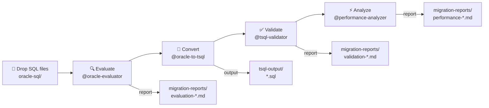
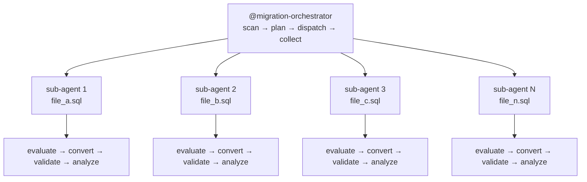
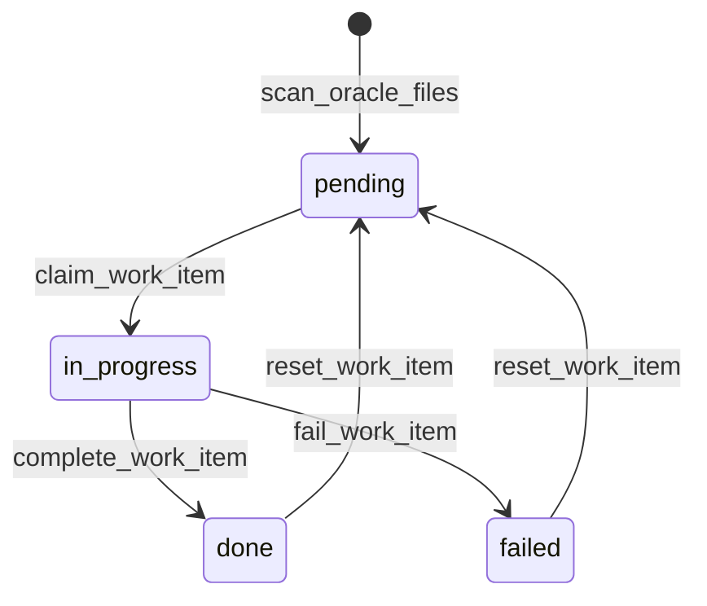

# Oracle to T-SQL Migration Toolkit

A GitHub Copilot-powered toolkit for migrating Oracle SQL/PL/SQL code to Microsoft SQL Server T-SQL. Uses custom agents, instructions, and extensions to evaluate, convert, validate, and optimize your SQL migration — with full support for batch processing across many files.


> 📺 Watch the [full demo video](docs/demo-fast.mp4) for a complete walkthrough of the migration pipeline.

## Quick Start

1. **Copy sample files** (or drop your own Oracle SQL files) into `oracle-sql/`:
   ```bash
   cp samples/*.sql oracle-sql/
   ```
2. **Run the full pipeline**: `@migration-orchestrator migrate all`
3. **Check status**: `@migration-orchestrator status`
4. **Review results** in `tsql-output/` and `migration-reports/`

> See [samples/README.md](samples/README.md) for detailed testing instructions.

## Documentation MCP Servers

The agents check behaviour they're unsure about against official documentation through two MCP servers. They work without them, but anything they couldn't check is marked `-- MIGRATION WARNING: unverified`. Rules for using them: [Verifying assumptions](.github/skills/oracle-tsql-reference/SKILL.md#verifying-assumptions).

| Server | Covers | Setup |
|--------|--------|-------|
| [Microsoft Learn MCP](https://learn.microsoft.com/en-us/training/support/mcp) | SQL Server, Azure SQL, T-SQL | Hosted; nothing to install |
| [Oracle Database Documentation MCP](https://github.com/oracle/mcp/blob/main/src/oracle-db-doc-mcp-server/README.md) | Oracle SQL and PL/SQL | Local Python server with a documentation index you build once |

Register them in your user configuration so every workspace can use them. This repo doesn't ship a `.vscode/mcp.json`, because the Oracle server path is machine-specific.

### Install the Oracle server

Needs Python 3.13+ and [uv](https://docs.astral.sh/uv/). Index the documentation for the Oracle version you migrate from; the rules in this repo cite 19c.

```bash
git clone https://github.com/oracle/mcp.git ~/.oracle/mcp-src
cd ~/.oracle/mcp-src/src/oracle-db-doc-mcp-server
uv sync --locked --no-dev

curl -L -o ~/.oracle/oracle-database_19.zip \
  https://docs.oracle.com/en/database/oracle/oracle-database/19/zip/oracle-database_19.zip
.venv/bin/python3 oracle-db-doc-mcp-server.py idx -path ~/.oracle/oracle-database_19.zip
```

The index is stored in `~/.oracle/oracle-db-doc-mcp-server/`. Building it takes several minutes; run `idx` again to refresh it. The official Docker image (`ghcr.io/oracle/mcp/oracle-db-doc`) builds in the 26ai index, which doesn't match 19c sources.

If your package index doesn't have every version in `uv.lock` yet (common with corporate mirrors), keep the current script and install the previous lock, which pins FastMCP 3.4.10. Don't run scripts older than commit `aa3294b`: their searches fail with a SQLite "objects created in a thread" error.

```bash
mkdir -p /tmp/prev && cd ~/.oracle/mcp-src
git fetch --depth 50 origin main
git show 6ea29c1:src/oracle-db-doc-mcp-server/pyproject.toml > /tmp/prev/pyproject.toml
git show 6ea29c1:src/oracle-db-doc-mcp-server/uv.lock > /tmp/prev/uv.lock
(cd /tmp/prev && uv export --locked --no-dev --no-emit-project -o requirements.txt)
cd src/oracle-db-doc-mcp-server
python3.13 -m venv .venv && .venv/bin/pip install --require-hashes -r /tmp/prev/requirements.txt
```

### Register both servers

VS Code: run **MCP: Open User Configuration** and add:

```json
{
  "servers": {
    "microsoft-learn": { "type": "http", "url": "https://learn.microsoft.com/api/mcp" },
    "oracle-db-doc": {
      "type": "stdio",
      "command": "/Users/<you>/.oracle/mcp-src/src/oracle-db-doc-mcp-server/.venv/bin/python3",
      "args": ["/Users/<you>/.oracle/mcp-src/src/oracle-db-doc-mcp-server/oracle-db-doc-mcp-server.py", "mcp"]
    }
  }
}
```

Copilot CLI: add the same servers under `mcpServers` in `~/.copilot/mcp-config.json`, with `"type": "local"` for `oracle-db-doc` and `"tools": ["*"]` on each.

## Project Structure

```
samples/                 ← Sample Oracle SQL files for testing (6 files, 🟢→🔴)
oracle-sql/              ← Drop Oracle SQL files here (source, read-only)
tsql-output/             ← Converted T-SQL output (auto-generated)
migration-reports/       ← Evaluation, validation & performance reports
.github/
  ├── copilot-instructions.md          ← Always-on project rules and critical semantic rules
  ├── skills/
  │   ├── oracle-tsql-reference/       ← On-demand mapping tables, patterns and sources
  │   └── oracle-data-profiling/       ← Oracle profiling and post-load reconciliation queries
  ├── instructions/
  │   ├── oracle-sql.instructions.md   ← Context for Oracle files
  │   ├── tsql-output.instructions.md  ← Standards for T-SQL output
  │   └── migration-reports.instructions.md
  ├── agents/
  │   ├── oracle-evaluator.md          ← @oracle-evaluator agent
  │   ├── oracle-to-tsql.md            ← @oracle-to-tsql agent
  │   ├── tsql-validator.md            ← @tsql-validator agent
  │   ├── performance-analyzer.md      ← @performance-analyzer agent
  │   └── migration-orchestrator.md    ← @migration-orchestrator agent
  └── extensions/
      └── oracle-migration/
          └── extension.mjs            ← Custom tools (scan, status, batch, state)
```

## Migration Pipeline



## Custom Agents

| Agent | Purpose | Example Usage |
|-------|---------|---------------|
| `@oracle-evaluator` | Assess migration complexity and risks | `@oracle-evaluator evaluate oracle-sql/pkg_orders.sql` |
| `@oracle-to-tsql` | Convert Oracle SQL → T-SQL | `@oracle-to-tsql convert oracle-sql/pkg_orders.sql` |
| `@tsql-validator` | Validate converted T-SQL correctness | `@tsql-validator validate tsql-output/pkg_orders.sql` |
| `@performance-analyzer` | Performance analysis and optimization | `@performance-analyzer analyze tsql-output/pkg_orders.sql` |
| `@migration-orchestrator` | Batch orchestration with parallel sub-agents | `@migration-orchestrator migrate all` |

## Custom Tools

### Discovery & Status
| Tool | Description |
|------|-------------|
| `scan_oracle_files` | Discovers Oracle SQL files, returns structured JSON with metadata |
| `migration_status` | Per-file status across all phases (pending/in_progress/done/failed) |
| `list_migration_reports` | Lists all generated reports with type classification |
| `generate_consolidated_report` | Merges all per-phase reports into a single consolidated report per file |
| `init_migration_project` | Creates project directories and initializes state |

### Batch Orchestration
| Tool | Description |
|------|-------------|
| `generate_batch_plan` | Generates dispatch plan with sub-agent prompts per file+phase |
| `claim_work_item` | Locks a file+phase as in_progress before dispatching |
| `complete_work_item` | Marks file+phase as done after sub-agent succeeds |
| `fail_work_item` | Records failure with error message for retry |
| `reset_work_item` | Resets a file+phase to pending for retry |

## Workflow

### Single File (use individual agents)

```
@oracle-evaluator evaluate oracle-sql/my_proc.sql
@oracle-to-tsql convert oracle-sql/my_proc.sql
@tsql-validator validate tsql-output/my_proc.sql
@performance-analyzer analyze tsql-output/my_proc.sql
```

### Batch Migration (use orchestrator with parallel sub-agents)

```
@migration-orchestrator evaluate all
@migration-orchestrator convert all
@migration-orchestrator migrate all    ← full 4-phase pipeline
@migration-orchestrator status
@migration-orchestrator retry failed
```

The orchestrator dispatches one sub-agent per file (up to 5 in parallel), tracks state via the extension, and aggregates results.



### Work Item State Machine



## Supported Oracle File Types

| Extension | Description |
|-----------|-------------|
| `.sql` | General SQL scripts |
| `.pls` | PL/SQL source |
| `.pks` | Package specification |
| `.pkb` | Package body |
| `.trg` | Trigger |
| `.vw` | View |
| `.fnc` | Function |
| `.prc` | Procedure |
| `.typ` | Type definition |
